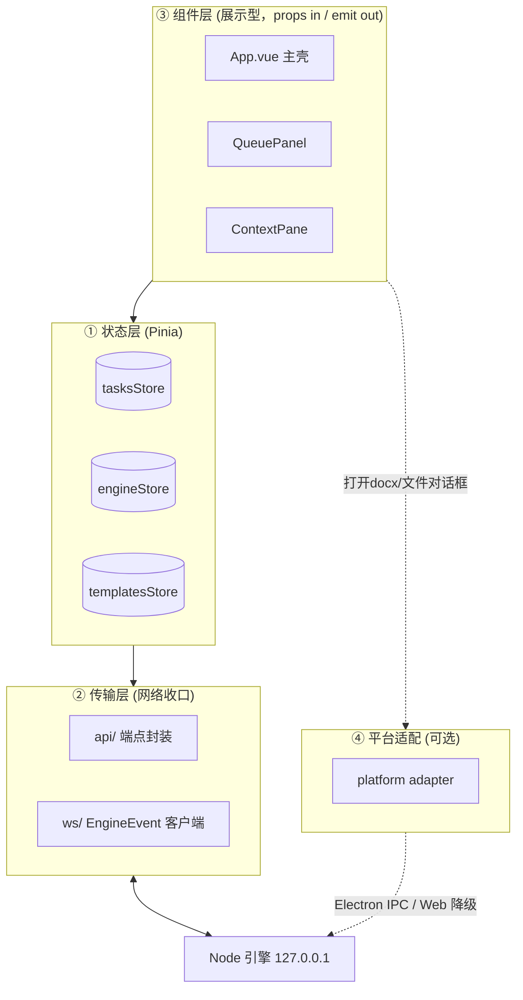
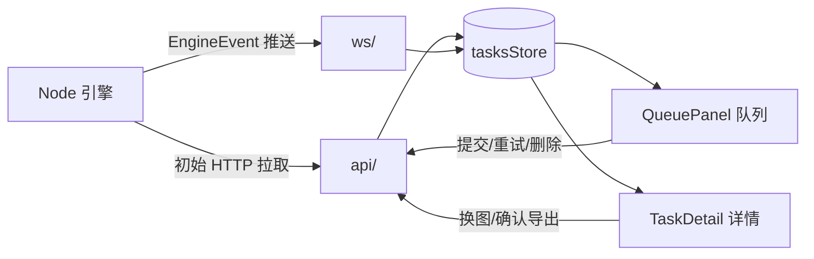

# 视频生成图文文章工具 — 前端架构与计划（Electron 渲染进程）

> 配套：《视频生成文章-架构文档》v0.5、《开发计划》、`CLAUDE.md`、`shared/types.ts`
> 范围：**只讲 Electron 渲染进程里的 Vue 3 部分**——组件、状态、与引擎的对接。系统级架构（引擎/打包/通信边界）见架构文档。

---

## 1. 原则

- **不要单模板**：一个巨型 `App.vue` 把队列/表单/进度/校对/帧选择器全塞进一个 `<template>`，在「AI 开发 + 多块独立状态」的场景下最糟——AI 难精准改动、reactive 状态互相纠缠。
- **也不要过度拆分**：单人内部工具，目标是**浅而扁的组件树 + 一个共享 store**，约 10 个组件，不搞深层级。
- **store 消灭 props 地狱**：队列和右侧详情读同一份状态，必须共享（Pinia），而非层层传 props——后者正是逼人退回单模板的根因。
- **全程 `<script setup>` + Composition API + TS**：AI 最熟、类型最顺。
- **先 Web 后 Electron 套壳**：渲染进程通过 localhost HTTP 访问引擎，浏览器版与 Electron 版同一套代码。

---

## 2. 四层架构



### ① 状态层（Pinia）— 骨架

- **`tasksStore`**（核心）：持有任务列表 + 当前选中任务 `selectedId`。初始用 HTTP 拉取，之后由 WS 的 `EngineEvent` 实时更新。队列与右侧详情都从它读。
- **`engineStore`**：引擎连接状态（connected / connecting / disconnected），驱动标题栏状态灯。
- **`templatesStore`**：Prompt 模板的增删改查。
- store 保持**小而专注**，只放状态与简单 mutation，网络调用不写在 store 里（交给传输层）。

### ② 传输层（`api/` + `ws/`）— 网络收口

- **`api/`**：对引擎 HTTP 端点的 typed 封装，全部用 `shared/types.ts` 的类型（见第 6 节）。
- **`ws/`**：订阅 `EngineEvent` 的 WebSocket/SSE 客户端，收到事件就 dispatch 进 `tasksStore`。
- **铁律：组件永远不自己 `fetch`、不自己开 socket**。所有网络从这一层进出。
- 附带好处：浏览器版与 Electron 版都指向 `127.0.0.1`，这层代码零改动即可平移。

### ③ 组件层 — 浅层级

```
App.vue                     主壳：master-detail 两栏 + 引擎状态灯
├─ QueuePanel.vue           左栏：读 tasksStore，渲染列表
│  └─ QueueItem.vue         单条：缩略图 / 状态徽章 / 进度条 / 状态操作
└─ ContextPane.vue          右栏：按"有无选中 + status"分发
   ├─ SubmitForm.vue        无选中：URL 主输入 + 折叠的高级选项
   │  └─ AdvancedOptions.vue
   └─ TaskDetail.vue        选中：按 status 切子视图
      ├─ ProgressView.vue   running：步骤 + 进度
      ├─ ReviewView.vue     awaiting_review：逐页校对
      │  ├─ ArticlePageCard.vue
      │  └─ FramePicker.vue 换图：逐秒帧网格，代表帧描边
      └─ ResultView.vue     completed：打开 docx / 重新生成
```

- 组件尽量**展示型**：props 进、emit 出，状态读写走 store。
- `ContextPane` 是右栏的"路由器"：无选中→`SubmitForm`；有选中→`TaskDetail`，再按 `task.status` 切 Progress / Review / Result。

### ④ 平台适配层（可选小层）

- 把只有 Electron 有的能力（在 Finder 打开 docx、原生文件对话框、通知）包成一个 `platform` adapter。
- Electron 下走 IPC 调主进程；纯 Web 版降级（如 docx 改为下载链接）。
- 保证 Vue 主体在浏览器与 Electron 里**完全一致**。

---

## 3. 核心数据流（只有一条，想清楚就不乱）



一句话：**WS 收到 `EngineEvent` → 更新 `tasksStore` → 队列与详情自动重渲染**。实时进度、状态流转都顺着这条走，组件不持有"真相"，只反映 store。

---

## 4. UI 布局草图（master-detail）

> 交互版草图见对话；此处用线框固化结构。实际为深色主题（按截图配色），结构是重点。

### 4.1 总体：左右分栏

```
┌──────────────────────────────────────────────────────────┐
│ ● ● ●      stillscribe — 视频生成图文文章     ● 引擎已连接 │  ← 标题栏 + 状态灯(engineStore)
├──────────────────┬───────────────────────────────────────┤
│ 任务队列          │  上下文区 (ContextPane)                 │
│ (QueuePanel)     │   · 无选中 → SubmitForm                 │
│  [QueueItem]…    │   · 选中   → TaskDetail                 │
│  常驻、可滚动     │     (按 status 切 Progress/Review/Result)│
└──────────────────┴───────────────────────────────────────┘
```

### 4.2 右栏 · 新建任务态（无选中 → SubmitForm）

```
┌───────────────────────────────────────────────┐
│ 新建任务 · YouTube URL（每行一个，单批 ≤10）   │
│ ┌───────────────────────────────────────────┐ │
│ │ https://www.youtube.com/watch?v=...        │ │  ← 主角，最大最显眼
│ │                                            │ │
│ └───────────────────────────────────────────┘ │
│ [ ▶ 提交任务 ]   默认即可开始                   │  ← 高对比度主 CTA
│ ▸ 高级选项  画质1080p·semi·chrome·去重开·阈值15 │  ← 折叠，平时只露摘要
└───────────────────────────────────────────────┘
```

把画质/模式/cookie/去重/阈值收进「高级选项」折叠区（`AdvancedOptions`），平时只露 URL + 提交。

### 4.3 右栏 · 校对态（选中 awaiting_review → ReviewView）

```
┌───────────────────────────────────────────────┐
│ Inside John's Castle        [✓ 确认并生成 docx] │  ← 标题 + 主 CTA
│ 共 8 页 · 点击配图可换图                         │
│ ┌─[图 00_00_42]─┬ 小标题 + 正文摘要 ──────────┐ │  ← ArticlePageCard × N
│ ├─[图 00_01_15]─┬ 小标题 …      (换图中) ─────┤ │  ← 选中页进入换图
│ │  帧选择器 (FramePicker)：逐秒帧网格          │ │
│ │  01_10 [01_15●] 01_17 01_19● 01_22 …        │ │  ← ●=去重代表帧(描边)
│ └─────────────────────────────────────────────┘ │
└───────────────────────────────────────────────┘
```

对应架构 M5/M7：逐秒全集都可挑，去重代表帧用描边标出；中文说明（notes）不出现在正文。

### 4.4 队列项（QueueItem）构成 + 六状态

每条 = 缩略图 + 标题 + 状态徽章（+ 进度条 / 状态操作）：

| status | 视觉 | 主操作 |
|---|---|---|
| `queued` | 灰徽章 | 取消 |
| `running` | 蓝徽章 + 当前步骤 + 进度条 | 取消 |
| `awaiting_review` | 琥珀徽章 + **高亮边框** | **去校对** |
| `completed` | 绿徽章 | 打开 docx |
| `failed` | 红徽章 | 重试 / 查看错误 |
| `canceled` | 灰徽章 | 删除 |

`awaiting_review` 是唯一在等用户动手的状态，需最显眼。

---

## 5. 关键决策与取舍

- **不用 vue-router（一期）**：选中任务就是 `tasksStore.selectedId` 一个状态，master-detail 靠它切右栏即可，比上路由简单。需要深链接/多窗口时再加。
- **不用单模板**：见第 1 节。
- **store 优先于 props**：跨栏共享状态一律走 store，避免 props 穿透。
- **组件展示化**：业务逻辑在 store/传输层，组件只负责渲染与发事件，便于 AI 改动与测试。
- **进度条粒度**：`running` 用 `EngineEvent` 的 `StepProgress`（step + ratio）驱动；不可量化的步骤显示 indeterminate。

---

## 6. 与后端契约的对接点（全部来自 `shared/types.ts`）

- **HTTP**（`api/` 封装）：
  - `POST /tasks`（`TaskParams | BatchSubmit` → `SubmitResult`）
  - `GET /tasks` / `GET /tasks/:id`（→ `Task` / `Task[]`）
  - `GET /tasks/:id/frames`（→ `Frame[]`，供 FramePicker）
  - `POST /tasks/:id/swap`（`SwapImageRequest`，换图）
  - `POST /tasks/:id/article`（`Article`，半自动回填）
  - `POST /tasks/:id/export`（`ExportRequest` → `ExportResult`）
  - `POST /tasks/:id/cancel`
- **WS/SSE**（`ws/` 客户端）：消费 `EngineEvent`（task_created / status_changed / progress / awaiting_review / completed / failed），dispatch 进 `tasksStore`。
- 前后端**同一份类型**，改契约先改 `shared/types.ts`。

---

## 7. 实现顺序（对应开发计划 P3）

**P3a — 纯浏览器 Vue 版（先做，摩擦最小）**

1. 搭 Vite + Vue3 + TS + Pinia 工程，引入 `shared/types.ts`。
2. 先写**地基两块**：`tasksStore` + `ws/` 客户端（其余组件都依赖它们）。
3. `api/` 端点封装。
4. `App.vue` 两栏壳 + `QueuePanel`/`QueueItem`（先把"实时看到任务跑"打通）。
5. `SubmitForm` + `AdvancedOptions`（能提交任务）。
6. `TaskDetail` → `ProgressView` / `ReviewView`(`ArticlePageCard` + `FramePicker`) / `ResultView`。
7. 验收：浏览器里全流程可用（引擎在本地跑）。

**P3b — Electron 套壳**

8. Electron 主进程加载渲染进程、spawn 引擎；渲染进程保持 `contextIsolation:true` / `nodeIntegration:false`。
9. 接 `platform` adapter（打开 docx、文件对话框、通知）。
10. 验收：双击 app 走完全程。
