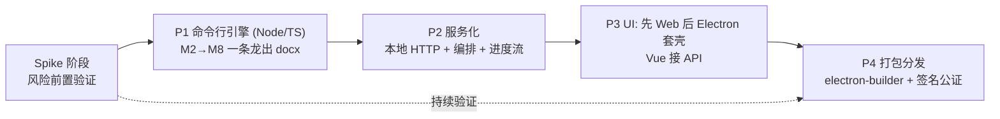

# 视频生成图文文章工具 — 开发计划（一期）

> 配套文档：《视频生成文章-架构文档》v0.5
> 适用范围：一期（纯桌面 macOS 版，单人开发）
> 技术栈：**UI = Electron + Vue 3；引擎 = Node.js + TypeScript（全 JS/TS 单栈，无 Rust）**
> 核心策略：**引擎先行、命令行验证、风险前置、接口契约后补、先 Web 后套壳**

---

## 0. 总体策略

五条原则，决定了下面的排期顺序：

1. **引擎先行**：先把 M2→M8 写成能跑的命令行 Node/TS 流程，再考虑服务化和 UI。真正的不确定性都在引擎里。
2. **命令行验证**：第一版不碰 Electron、不碰 HTTP，`tsx run.ts <url>`（或 bun）一条龙出 docx，最快暴露真问题。
3. **风险前置**：把最可能卡住的点（Gemini 稳定吐 JSON、一趟 ffmpeg 水印、docx 保真、electron-builder 打包签名）抽成独立 spike，尽早小验证。
4. **接口契约后补**：HTTP/WS 契约等引擎跑通后再定；现在只锁定最难改的两件——目录命名约定 + M7 的 JSON 类型（架构文档已定）。**契约用共享 TS 类型，前后端同一份。**
5. **先 Web 后套壳**：UI 先做纯浏览器 Vue 版（接引擎本地 HTTP），摩擦最小；跑通后再 Electron 套壳，前端几乎原样平移。

---

## 1. 里程碑总览

| 里程碑 | 目标 | 相对体量 | 关键产出 |
|---|---|---|---|
| **Spike** | 验证四个高风险点可行 | S | 四份可行性结论 + 最小样例 |
| **P1** | 命令行引擎跑通全流程 | L | `run.ts <url>` → `article_final.docx` |
| **P2** | 引擎服务化 + 任务编排 | M | 本地 HTTP/WS + 共享类型契约 v1 |
| **P3** | Vue UI（先 Web 后 Electron） | L | 可双击使用的桌面 app（开发态） |
| **P4** | 打包、签名、分发 | M | 可在干净 mac 运行的 `.app`/`.dmg` |

> 体量为相对估计（S/M/L），非工时承诺；单人开发按此顺序串行推进，Spike 可与 P1 早期并行。

---

## 2. Spike 阶段（风险前置，最先做）

四件事越早确认越好；S4 不要拖到 P4 才发现卡住（Electron 路径风险已较低，仍建议先验）。

### S1 — Gemini 稳定输出严格 JSON（最高风险）

- 验证现有 Prompt 改造成「输出 JSON」后能否稳定返回可解析结构（每页 `{subhead, image, body}` + 文末 meta）。
- 先用免费网页版验证 Prompt 可行，再用 API 验证可编程稳定性。
- 产出：可用的 JSON 版 Prompt 模板；失败率与坏样本（决定 M8 要不要做容错解析）。
- 影响模块：M7、M8。

### S2 — 一趟 ffmpeg 完成抽帧 + 缩放 + 水印 + webp

- 验证单条 ffmpeg（`fps=1,scale=640:360,drawtext(pts)` → webp）水印是否清晰、时间戳是否与帧序号/文件名精确对齐；并验证 HD 1280×720 另一趟产出。
- 产出：定型的两条 ffmpeg 命令。
- 影响模块：M3。

### S3 — Node docx 排版保真度

- 用 `docx`(dolanmiu) 生成一份目标排版样张（小标题 + 等比居中配图 + 正文 + 文末 meta），对照现有 python-docx 产出确认不劣化。
- 这是当初决定「弃 Python 用 Node」时唯一要先验证的点。
- 产出：可复用的 docx 生成样例 + 结论（过关则无需再留 Python）。
- 影响模块：M8。

### S4 — electron-builder 打包：原生模块 + 内置 CLI + 签名公证

- 做一个最小 Electron app，用 **electron-rebuild** 编译 `sharp`/`better-sqlite3` 并经 electron-builder 打包（含 asarUnpack），同时用 **extraResources** 内置一个 CLI 二进制（如 ffmpeg），以 bundle 内**绝对路径**（`process.resourcesPath`）调用，完成 codesign（hardened runtime）+ 公证 + staple，在**另一台干净 mac** 上双击能跑、不被 Gatekeeper 拦。
- 重点验证**原生模块经 electron-rebuild 后可正常加载**（架构文档待讨论项 11）。
- 产出：可复用的 electron-builder 配置 + 签名公证脚本骨架。
- 影响阶段：P4（但现在验证；相比 Tauri+SEA 路径，风险已降低）。

---

## 3. P1 — 命令行引擎（核心里程碑，Node/TS）

**目标**：`tsx run.ts <youtube_url>`（或 bun）一条龙跑完 M2→M8，输出带配图的 `article_final.docx`；每个模块也能单独调用、单步重跑。

### 3.1 脚手架与公共设施

- [ ] Node/TS 项目结构 + 包管理（pnpm/bun）+ 依赖（`docx`、`sharp`、Gemini SDK/`fetch`、`better-sqlite3` 视 P2 需要）。
- [ ] **路径/命名约定模块**：集中管理工作目录结构（`source/ 01_hd/ 02_webp/ 03_grids/ article/`）与 `HH_MM_SS` 命名规则——最难回改，先定死（架构文档第 7 节）。
- [ ] **共享类型包**：把 M7 的 JSON 类型、任务/参数类型定义在一个可被前后端共用的 TS 模块里。
- [ ] CLI 调用封装：统一以**绝对路径** spawn ffmpeg/yt-dlp/ImageMagick/cwebp（提前规避 P4 的最小 PATH 坑）。
- [ ] 每个模块「幂等、产物落盘、可单步重跑」。

### 3.2 模块实现（按依赖顺序）

- [ ] **M2 下载**：spawn yt-dlp（默认 1080p / 可选 1440p、人工+自动英文字幕转 srt、`--cookies-from-browser`）；失败给明确提示。
- [ ] **M3 帧生成**（优化①）：单趟 ffmpeg 产出 640×360+水印 webp 全集 + 1280 HD 全集；命名直接 `HH_MM_SS`；引擎内不引入图像库做二次编码。
- [ ] **M5 去重选帧**（优化②）：`sharp` 计算 phash 选**代表帧清单**，阈值可配；逐秒全集原样保留。
- [ ] **M6 宫格图**：spawn montage 把**代表帧**拼成 10×5/组。
- [ ] **M7 文章生成**（优化③上游）：套用 S1 定型的 JSON Prompt；先做半自动（人工粘贴回填）跑通，再接 Gemini API 自动模式；Prompt 模板化。
- [ ] **M8 文档组装**（优化③下游）：用 `docx`(dolanmiu) 读 JSON **程序化一次性生成** docx（小标题、`ImageRun` 等比居中配 HD 图、正文、meta）；中文说明留 JSON 字段不进正文。
- [ ] **M9 导出**：先支持本地 docx 落盘（飞书上传留待评估）。
- [ ] **M10 视频切片**（可选、低优先）：spawn ffmpeg 切等比 800×450 的 N 秒片段。

### 3.3 串联与验收

- [ ] `run.ts` 把上述模块串成一条龙，支持「从某一步重跑」。
- [ ] **验收标准**：给一条真实 YouTube URL，命令行能产出可用的 `article_final.docx`，配图正确、正文与 meta 完整。

---

## 4. P2 — 服务化（本地 HTTP + 编排）

**目标**：把已跑通的引擎函数包成本地服务，加上任务编排与进度推送；I/O 已稳定，**顺手固化共享类型契约 v1**。

- [ ] 用 Fastify/Hono 在 `127.0.0.1` 暴露端点：提交任务、查询状态、取逐秒帧列表、换图、触发导出。
- [ ] **任务编排**：队列 + 限流（单批 ≤10、间隔可配）+ 状态机 + SQLite（`better-sqlite3`）元数据。
- [ ] **进度推送**：WebSocket 或 SSE 实时回传各步骤进度/状态。
- [ ] （可选）下载与处理流水线重叠：A 抽帧时 B 下载，提升吞吐而不增加 YouTube 请求频率。
- [ ] **固化契约 v1**：HTTP 端点 + WS 事件 + M7 JSON schema，全部落成**共享 TS 类型**。
- [ ] 引擎可被外部优雅拉起/退出（为 P3 的 Electron 主进程托管铺路）。
- [ ] **验收标准**：用 curl/浏览器提交任务，能看到进度流、最终拿到 docx。

---

## 5. P3 — UI（先纯 Web，后 Electron 套壳）

**目标**：纯界面走完全程；UI 只做展示 + 系统集成 + 托管引擎进程，不含业务逻辑。

### 5.1 P3a — 纯浏览器 Vue 版（摩擦最小，先做）

- [ ] Vue 3 + Vite 工程，引入共享类型包，对接 P2 的 HTTP + WS/SSE。
- [ ] 界面：URL 输入/批量队列、任务进度看板、**换图画廊**（虚拟滚动加载逐秒全集）、Prompt 模板管理、导出/发布。
- [ ] **验收**：浏览器里全流程可用（引擎在本地跑）。

### 5.2 P3b — Electron 套壳

- [ ] Electron 工程加载 Vue 渲染进程（开发期指向 Vite dev server，打包指向构建产物）。
- [ ] 主进程（Node）：启动时 spawn Node 引擎（utilityProcess 或 child_process.fork）、退出回收、崩溃重启。
- [ ] **渲染进程安全默认**：`contextIsolation: true`、`nodeIntegration: false`；渲染进程只通过 localhost HTTP 访问引擎，不直接用 Node。
- [ ] 系统集成走 Electron API：菜单、文件对话框、通知、全磁盘访问首启引导。
- [ ] **验收**：双击 app，纯界面输入 URL → 看进度 → 换图 → 导出 docx。

---

## 6. P4 — 打包、签名、分发

**目标**：干净 mac 上双击 `.app`/`.dmg` 能跑，不被 Gatekeeper 拦。（最小链路已在 S4 验证）

- [ ] 引擎随 Electron 内置 Node 运行（转译 JS），由 electron-builder 打包（可启用 asar）。
- [ ] 原生模块（sharp/better-sqlite3）经 **electron-rebuild** 编译，含原生 `.node` 的包放进 `asarUnpack`。
- [ ] ffmpeg/ffprobe/yt-dlp/ImageMagick/cwebp 经 **extraResources** 内置，全部绝对路径调用（`process.resourcesPath`）。
- [ ] electron-builder 配置 codesign（hardened runtime）+ notarize + staple（含原生模块/内置二进制），写进 CI。
- [ ] 首启权限引导（完全磁盘访问）。
- [ ] （可选）自动更新（electron-updater）。
- [ ] **验收标准**：另一台未装任何依赖的 mac，双击安装即用。

---

## 7. 一期范围边界（不做）

- 团队共享的服务端 / 多人协作（二期：薄 Web 控制台 + 本地 agent）。
- 在线直接截图（测试不可行）。
- 完整权限/账号体系、多账号多 IP 调度。
- 跨平台分发（一期仅 macOS）。
- 包体积优化（Electron 含 Chromium，一期不优化）。

---

## 8. 未决事项与解决时点

| 待定项 | 建议在哪个阶段定 |
|---|---|
| 批量是顺序还是并发、限流参数 | P2（编排时） |
| 多 URL 的账号/IP 风险 | P2 之前小调研，P2 落参数 |
| 命名一步到位是否有回退必要 | P1（M3 实测确认） |
| 字幕清洗（去重复行、压 token） | P1 附带评估，视质量决定是否加 |
| 宫格图 vs 自动模式直发单帧 | S1/P1（连同 Gemini 模式一起验证） |
| Node docx 排版保真度 | **S3（前置 Spike）** |
| 原生模块 electron-rebuild 兼容性 | **S4（前置 Spike）** |
| 飞书自动调图 API | 二期 |
| 素材存本地 vs 在线共享 | P1 默认本地，后续按需再议 |
| 去重相似度阈值校准 | P1（M5 用真实素材调） |
| 中间产物自动清理 | P2（编排时加开关，低优先） |
| 包体积是否需控制 | 一期不做，二期评估 |

---

## 9. 建议的起步顺序（务实版）

1. 先做 **S1 + S2 + S3**（半天到一两天的小验证）：确认 Gemini JSON、ffmpeg 水印、Node docx 保真三条命脉可行——尤其 S3 决定了「弃 Python」这个决定能否成立。
2. 直接进 **P1**，把 Node/TS 命令行引擎跑通——回报最高、最该尽快拿到的成果。
3. P1 跑顺、对 I/O 有把握后，依次 P2 → P3a（纯 Web）→ P3b（Electron 套壳）。
4. **S4 可在 P1 期间穿插**：把 electron-builder + electron-rebuild 原生模块 + 内置 CLI + 签名公证最小链路跑通一次。Electron 路径比此前 Tauri+SEA 成熟，风险较低，但仍值得早验。
