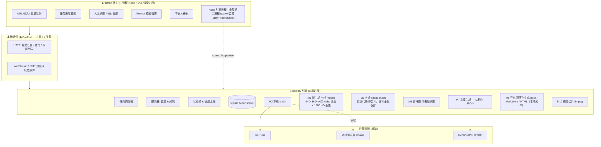
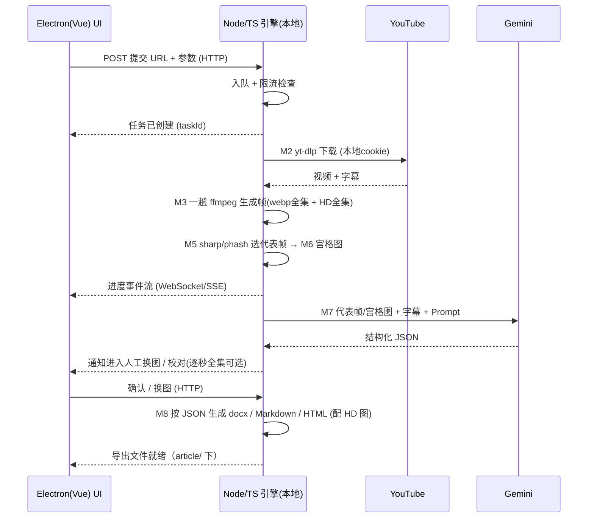

# 视频生成图文文章工具 — 架构设计文档（一期）

> 版本：v0.5（一期 / 纯桌面 macOS 版）
> 目标读者：开发者本人 + 后续协作工程师
> 形态结论：**纯桌面 macOS 应用** —— **Electron + Vue（UI 宿主） + Node/TS 引擎（本地）**，两者通过本地 HTTP/WebSocket 通信
> 变更摘要（相对 v0.4.1）：跨端框架由 Tauri 改为 **Electron**。连带影响：去掉 Rust 壳，全栈变为纯 JS/TS（主进程 Node + 渲染进程 Vue + Node 引擎）；引擎由 Electron 主进程 spawn/监督（utilityProcess/fork）；打包由「Node SEA/Bun 单二进制」改为「**electron-builder**，引擎随 Electron 内置 Node 运行、原生模块走 **electron-rebuild**」——打包风险显著降低。代价：包体积明显变大（含 Chromium）、内存占用更高，对内部工具可接受。
> **2026-11 变更（导出）**：产品定位收敛为「视频 → 营销文章 + 关键配图」，内容产出以**本地文件**为主。M8 由「只出 docx」扩展为「docx / Markdown / HTML 三种本地文件」；**M9 发布（飞书）取消**，飞书集成代码与《飞书集成》文档已移除，出站请求只剩 YouTube 与 Gemini。下文相关条目已同步修改。
> 选 Electron 的核心动因仍是「深度使用 AI 开发」：AI 对 Electron 的语料远多于 Tauri，生态最成熟，且 Electron 主进程即 Node，与 Node 引擎、Vue 前端凑成「无 Rust 的纯 JS/TS 单栈」。

---

## 1. 背景与目标

### 1.1 背景

当前根据 YouTube 视频产出图文文章的流程为纯手工 + 一堆零散命令行脚本：边看视频边手动截图、转格式、上传组内 AI 工具、手动排版配图、人工检验。遇到 15 分钟以上的视频工作量很大，且一次只能处理一个视频。

现有手工流程已经跑通，依赖以下本地命令行工具：`yt-dlp`、`ffmpeg`、`ImageMagick`、`webp(cwebp)`，外加一些 Python 脚本（Pillow / imagehash / python-docx）。新版引擎将用 Node/TS 重写这部分脚本逻辑（CLI 调用方式不变）。

### 1.2 一期目标

把现有流程封装成一个可操作的工具，达到：

- 输入 1 个或多个 YouTube URL，工具自动完成**下载 → 帧生成（含水印/转码）→ 去重选帧 → 拼宫格图**的全部预处理；
- 提供文章生成环节（自动调用 Gemini API，或半自动“一键准备好素材供人工粘贴”两种模式）；
- 提供人工换图 / 校对界面；
- 一键导出带配图的本地文件（`docx` / Markdown / HTML）；
- 内置依赖，免去用户手动 `brew install` 一长串工具。

### 1.3 非目标（一期不做）

- 团队共享的服务端 / 多人协作（留二期）；
- 在线直接截图（不下载视频）——经测试不可行，一期沿用“先下载再抽帧”；
- 完整的权限 / 账号体系；
- 跨平台分发（Electron 本身跨平台，但一期只针对 macOS：流程深度绑定 macOS 环境）。

---

## 2. 形态决策

### 2.1 为什么是纯桌面（而非服务端）

| 维度 | 桌面 / 本地优先 | 纯 Web（服务端） |
|---|---|---|
| YouTube 风控 | 本机住宅 IP + 本地浏览器 cookie，最贴近正常观看，风险低 | 机房 IP 集中下载，易被限速 / 封禁；需上传个人 cookie，安全隐患 |
| 算力 / 带宽成本 | 白嫖用户本机闲置算力，零边际成本 | 抽帧 / 转码 / 拼图全是 CPU·磁盘密集型，按量付费且难并发 |
| 工具适配 | ffmpeg / yt-dlp / ImageMagick 本就是本地 CLI，打包即用 | 服务端需额外解决沙箱、隔离、临时文件清理 |
| 文件操作 | 大量图片文件夹、docx、人工换图，本地原生 | 反复上传下载，体验差 |
| 团队共享 | 弱（需各自安装） | 强（免安装、集中更新） |

**结论**：一期采用纯桌面应用。团队共享是 Web 的唯一明显优势，但本流水线的下载与重计算无法上服务端，因此把共享能力推迟到二期。

### 2.2 “本地”的准确含义

整个应用 100% 运行在用户本机：Electron（主进程 + 渲染进程）、Node 引擎、所有 CLI、全部文件、浏览器 cookie 都在本地。其中 Node 引擎以本地 HTTP 服务形式监听 `127.0.0.1`，在网络协议意义上是个 server，但在物理位置意义上**从不离开用户电脑**，不部署到任何远程机房。

唯一真正发往远程的，是引擎代码主动发出的**出站第三方 API 调用**，而非运行环境本身：

- `yt-dlp → YouTube`（下载视频 / 字幕）
- `Gemini API`（自动模式生成文章）

即：进程在本地，只是像浏览器一样对外请求这两个服务。

---

## 3. 技术选型

| 层 | 选型 | 理由 |
|---|---|---|
| UI 宿主 | **Electron + Vue 3（渲染进程） + TS（主进程）** | 复用前端技能、Node 原生集成、electron-builder 打包成熟、AI 熟悉度高；无 Rust，全 JS/TS；换图画廊用 Vue 虚拟滚动 |
| 处理引擎 | **Node.js + TypeScript**（本机进程，由 Electron 主进程 spawn/监督） | 与渲染进程/主进程同语言，全 TS 单栈；AI 代码质量高且可监督；子进程编排/流式进度是 Node 母语场景 |
| Web 框架 | **Fastify / Hono**（择一） | 轻量、TS 友好 |
| UI ↔ 引擎通信 | **本地 HTTP + WebSocket/SSE**，**端到端共享 TS 类型** | 即便在 Electron 内仍走 HTTP 而非 Electron IPC，以保留「先纯 Web 后套壳」与 UI 解耦（详见第 4、9 节） |
| 编排（队列 / 限流 / 状态机） | **归属 Node 引擎** | 长耗时流水线、重试、限流、SQLite 都在引擎侧集中管理；UI 保持薄客户端 |
| 关键库 | **`docx`(dolanmiu) 生成 Word、`sharp`(+phash) 去重** | 替代 python-docx / imagehash；均成熟、TS-first |
| 外部 CLI | yt-dlp / ffmpeg / ffprobe（宫格拼图用 ffmpeg `tile`，已弃 ImageMagick；webp 由 ffmpeg libwebp 直出，无需 cwebp） | 随安装包内置二进制，不依赖用户 `brew install` |
| 引擎运行时打包 | **由 Electron 内置 Node 承载，electron-builder 打包** | 引擎以 JS 形式随 app 分发，无需编译成独立二进制 |
| 任务 / 元数据存储 | **SQLite**（`better-sqlite3`，经 electron-rebuild 编译；本地单文件，由引擎持有） | 记录任务状态、进度、产物路径，轻量无需独立服务 |
| 素材存储 | 本地文件系统（工作目录） | 详见第 7 节目录约定 |

### 3.1 为什么 UI 用 Electron+Vue、引擎用 Node/TS（而非 Swift / Python / Tauri）

决策核心前提是**深度使用 AI 进行开发**。判断一个栈是否适合 AI 开发看两点：AI 写得好不好、你能否看出它写错。据此：

- **UI 选 Electron+Vue（弃 Swift、亦不用 Tauri）**：AI 在 Web（Vue/TS）上的产出远强于 SwiftUI，你又熟 Vue 能监督；Web 反馈闭环（热重载 / devtools / 无头测试）比 Xcode 紧得多。相比 Tauri，Electron 进一步占优于本场景——AI 对 Electron 的训练语料远多于 Tauri，生态最成熟；且 **Electron 主进程就是 Node**，与 Node 引擎、Vue 前端凑成「无 Rust 的纯 JS/TS 单栈」，AI 始终一个语言；electron-builder 对**原生模块编译 + 签名公证**的支持比 Tauri sidecar 成熟，直接降低打包风险。
- **引擎选 Node/TS（弃 Python）**：引擎 ≈ 90% 是「调 CLI + 发 HTTP」，两语言皆可；真正依赖库的只有 docx 与 phash 两处，Node 的 `docx`(dolanmiu) 与 `sharp` 都已足够成熟。换 Node 换来：与渲染/主进程全 TS 单栈、接口契约端到端共享 TS 类型、类型系统帮你抓 AI 幻觉、单一工具链。代价是重写现有 Python 脚本（多为薄封装，AI 可快速移植）。

> 代价与权衡：Electron 打包含 Chromium，**体积明显更大（常 100MB+）、内存占用更高**；对内部工具可接受。若极在意体积/内存、愿接受 Rust 与较新生态，Tauri 仍是更轻的备选。若判断 docx 排版未来会非常复杂或不愿重写脚本，Python 引擎仍可备选。

职责分工：**Electron 主进程（Node）** 负责加载渲染进程 + spawn/监督 Node 引擎 + 系统集成；**渲染进程（Vue）** 负责 UI；**Node 引擎** 负责编排 + 处理 + 数据。引擎为独立进程，保证崩溃隔离。

---

## 4. 总体架构与通信边界



分层职责：

- **Electron 宿主**：渲染进程（Vue）负责展示与交互；主进程（Node）负责系统集成（菜单、文件对话框、通知、全磁盘访问引导）+ 在启动时拉起 Node 引擎、退出/崩溃时回收或重启该进程。不含业务逻辑。
- **本地通信边界**：渲染进程通过 HTTP 下命令、WS/SSE 收进度，契约用共享 TS 类型。**刻意不用 Electron IPC 直连引擎**——保持 HTTP 边界，引擎被一套干净 API 封住后，UI 是 Electron 还是纯浏览器都不锁死（支撑第 9 节「先 Web 后套壳」）。
- **Node 引擎**：编排（队列 / 限流 / 状态机）+ 处理（M0–M10）+ 持有 SQLite。每个处理模块「幂等、可单步重跑、产物落盘」，便于失败重试与单步调试。

---

## 5. 核心模块拆分

每个模块对应原流程的一个阶段，均设计为「幂等、可单步重跑、产物落盘」，位于 Node 引擎内。

| 模块 | 名称 | 输入 | 输出 | 实现要点 |
|---|---|---|---|---|
| M0 | 环境自检 / 依赖管理 | — | 各 CLI 可用性报告 | 内置二进制替代手工 `brew install` |
| M1 | 任务输入 & 队列 | URL 列表、参数 | 任务记录入库 | 新增 |
| M2 | 下载引擎 | URL、画质、cookie 来源 | mp4 + 字幕(srt) | spawn `yt-dlp` 合并命令 |
| **M3** | **帧生成** | mp4 | ① 640×360+水印 webp 全集；② 1280×720 HD 全集 | **一趟 ffmpeg** 完成抽帧+缩放+水印+转码；**无图像库二次解码编码** |
| **M5** | **去重选帧（默认开启）** | 640×360 webp 全集 | **代表帧清单**（供 M6/Gemini） | `sharp` 计算 phash 选代表帧；**只筛喂 AI 的那一份，逐秒全集原样保留供换图** |
| M6 | 宫格图 | **去重后代表帧** | 10×5=50 张/组拼图 | ffmpeg `tile` 滤镜拼图（原 ImageMagick `montage`，为自包含已弃用，2026-06 决策）；输入量从数千降到数百 |
| **M7** | **文章生成 → 结构化 JSON** | 宫格图/代表帧 + 字幕 + Prompt | **结构化 JSON**（每页 + meta，复用共享 TS 类型） | Gemini（自动 API / 手动网页版），Prompt 要求输出 JSON |
| **M8** | **文档导出（程序化）** | M7 的 JSON + 1280 HD 图 | `article_final.docx`、`article.md`、`article.html`（+ 单文件版）、`images/` | **`docx`(dolanmiu)** 按结构一次性生成；Markdown / HTML 由引擎直接渲染文本，配图从 `01_hd` 原样拷贝并按页重命名（不再编码）；砍掉 BBedit 中转 / 先生成再调图 / 删除中文 |
| ~~M9~~ | ~~发布~~ | — | — | 已取消（2026-11）：产出以本地文件为主，不再对接飞书 |
| M10 | 视频切片（可选） | mp4 | 等比 800×450 的 N 秒片段 | spawn `ffmpeg` 切分 |

### 5.1 M2 下载引擎（关键）

- 默认画质 1080p，可选 1440p；使用 `<=` 而非 `=`，避免无对应分辨率时下载失败。
- 同时拉取人工英文字幕与自动英文字幕，统一转 `srt`。
- **Cookie**：通过 `--cookies-from-browser`（Safari / Chrome 可选）读取本机浏览器 cookie 过验证——这是必须放在本地的核心原因。
- 失败时给出明确提示（网络 / 浏览器是否关闭 / 完全磁盘访问权限）。

### 5.2 M3 帧生成（优化①：一趟 ffmpeg）

原手工链路是 `ffmpeg 抽帧→jpg → Pillow 解码→缩放→加水印→再编码 webp`，多次有损接力。优化为 **ffmpeg 单趟从源视频直接产出成品帧**，Node 引擎里不再引入任何图像库做二次编码：

- 一条 ffmpeg 命令完成：`fps=1` 抽帧 + `scale=640:360` 缩放 + `drawtext`（`pts` 时间戳，半透明黑底白字、字号 28、左上角固定）+ 输出 webp。
- 命名直接产出 `HH_MM_SS`（fps=1 从 0 开始，第 N 帧即第 N 秒，纯算术映射），不再复制出第二份文件夹。
- HD 1280×720 全集由源视频另起一趟 ffmpeg 产出，既供人工换图浏览，又作为 M8 配图源。
- 实现细节：需校准 `pts` 时间戳与帧序号/文件名的对齐，是细节而非障碍。

### 5.3 M5 去重选帧（优化②：仅服务于喂 AI 的代表帧，默认开启）

逐秒抽帧对 39 分钟视频就是 2340+ 张，相邻帧高度重复。去重专门服务于「喂给 Gemini 的那一份」：

- **逐秒全集（640 webp + 1280 HD）原样保留**，人工换图时仍可逐秒连续挑选。
- 用 `sharp` 解码后计算 phash（或 `sharp-phash` / `imghash`）选**代表帧清单**进入 M6。
- 喂 AI 的图量从数千降到数百，宫格图组数、上传量、token 全线下降，配图质量不降反升。
- 相似度阈值可配置，用真实素材校准。

### 5.4 M7 文章生成 → 结构化 JSON（优化③上游）

把 Gemini 输出从「纯文本文章」改为**结构化 JSON**，其 schema 用与前端共享的 TS 类型定义：

- 每页一个对象：`{ subhead: string; image: string /* HH_MM_SS */; body: string }`；
- 文末 meta：`{ titles: string[]; keywords: string[]; description: string }`；
- 中文说明（框架对比、配图 CoT）放进**独立字段**，不混入正文。

两种模式：自动（Gemini API 直接拿回 JSON，Key 存本地）/ 半自动（网页版，工具备好素材一键复制，人工回填）。Prompt 以模板管理，可编辑、可多版本。

### 5.5 M8 文档组装（优化③下游：程序化一次性生成）

拿到 M7 的 JSON 后，用 `docx`(dolanmiu) **按结构一次性生成整篇 docx**：

- 序号本就在 JSON 里 → BBedit 中转取消；
- 按每页结构直接插小标题、配图（`ImageRun` 等比居中，配图源取 1280 HD）、正文 → “先生成再调图填空行”取消；
- 中文说明在 JSON 独立字段、不进正文 → “删除中文”取消。

三步合一，不再依赖手工复制粘贴。`docx` 为 TS-first、零运行时依赖，从零生成场景完全够用。

---

## 6. 数据流（单任务时序，优化后）



---

## 7. 目录与存储约定

每个任务一个独立工作目录，避免文件互相污染、便于清理：

```
<工作根目录>/
└── <任务ID_视频标题>/
    ├── source/              # 原始 mp4 + 字幕
    ├── 01_hd/               # 1280x720 逐秒 HD (人工换图浏览 + M8 配图源)
    ├── 02_webp/             # 640x360 + 水印 逐秒 webp (供 M5 去重 / M6 宫格图)
    ├── 03_grids/            # 去重后代表帧拼的宫格图 (喂 Gemini)
    ├── article/            # article.json (M7) + article_final.docx (M8)
    ├── mp4_clips/           # 视频切片(可选)
    └── task.json            # 任务元数据快照
```

- M3 一趟 ffmpeg 直接产出 `01_hd/` 与 `02_webp/`，**不保留原始 jpg 中间层**。
- M5 去重只产出**代表帧清单**（记在 `task.json` 或单独 manifest），逐秒全集不被移动/删除。
- **任务元数据**统一进 SQLite（由 Node 引擎持有：状态、参数、各步骤产物路径、时间戳），`task.json` 为可读快照。
- **素材存哪里**为待定项：本地工作目录是默认方案；是否同步到在线共享文档见第 11 节待讨论。

---

## 8. 打包、签名与分发（macOS）

**核心原则：全部依赖随 app 分发，用户端零安装、零配置**——不要求用户装 Node、不要求 `brew install` 任何 CLI。整体由 **electron-builder** 产出 `.app`/`.dmg`。代价是 app 体积偏大（含 Chromium）。

依赖分**两类**，处理方式不同，开发时务必区分：

| 依赖 | 例子 | 开发期 | 分发给用户 |
|---|---|---|---|
| **第一类：npm 库** | `docx`、`sharp`、`better-sqlite3`、Fastify | `pnpm install` 到 `node_modules`（不进 git） | 随 Electron 内置 Node 运行，**electron-builder 打包**（无需编译成独立二进制） |
| 其中：原生模块 | `sharp`(libvips)、`better-sqlite3` 的二进制部分 | 随 npm 装 | **electron-rebuild** 按 Electron 的 Node ABI 编译，electron-builder 打包（asarUnpack） |
| **第二类：CLI 程序** | ffmpeg/ffprobe、yt-dlp（宫格拼图用 ffmpeg `tile`，已弃 ImageMagick） | 放项目 `bin/`，指本机路径 | electron-builder **extraResources** 内置进 `.app` |

### 8.1 第一类：npm 库 → 随 Electron 内置 Node 运行

- 开发期用 `pnpm install` 装进 `node_modules`（进 `.gitignore`）。
- **无需 Node SEA / Bun 编译**：Electron 自带 Node 运行时，引擎以转译后的 JS 形式随 app 分发，由 electron-builder 打包（可启用 asar）。用户机器无需装 Node。
- **原生模块**（`sharp`/`better-sqlite3`）：不是纯 JS，需用 **electron-rebuild** 针对 Electron 的 Node ABI 重新编译，再由 electron-builder 打包；含原生 `.node` 的包要放进 `asarUnpack` 以保证可加载。这是成熟、AI 熟悉的路径，比此前「单二进制吞原生模块」风险低得多。

### 8.2 第二类：CLI 程序 → extraResources 内置

- ffmpeg/ffprobe、yt-dlp 是独立可执行程序，**不走 npm 链路**（宫格拼图改用 ffmpeg `tile` 滤镜，已弃用 ImageMagick；webp 由 ffmpeg libwebp 直出，无需 cwebp）。
- 预先下好对应 macOS 架构的二进制放进项目 `bin/`（开发期用 `pnpm setup-tools` 拉取静态构建），在 electron-builder 的 **`extraResources`** 中声明，打包时塞进 `.app`（`Contents/Resources/`）。
- **最小 PATH 坑**：从 Finder/打包后启动只有精简 PATH（`/usr/bin:/bin:/usr/sbin:/sbin`），开发时 `ffmpeg` 直跑、打包后会失效——**所有 CLI 必须用 bundle 内绝对路径调用**（通过 `process.resourcesPath` 解析），不可依赖 PATH 或全局安装。
- **yt-dlp 自更新**（二期话题）：yt-dlp 需频繁更新跟上 YouTube 改版，宜为内置 yt-dlp 设计自更新机制。

### 8.3 签名与公证（覆盖两类）

- 引擎依赖的原生 `.node`/`.dylib`、以及第二类的每个 CLI 二进制，**全部**需 **codesign**（hardened runtime）；整个 `.app` 再走 **公证 + staple**。
- **electron-builder 集成了 codesign + notarize 流程**（含对内置二进制/原生模块的签名），比手工链路成熟；配好证书与 `notarize` 选项即可，建议写进 CI。

### 8.4 系统权限

- M2 读取浏览器 cookie、读写工作目录可能触发 **完全磁盘访问**；首启提供清晰引导（指向 系统设置 → 隐私与安全性）。

---

## 9. 演进与迁移路径

得益于第 4 节的本地 HTTP/WS 边界，引擎以「干净 API」对外，因此一期不必赌定终局：

- **分阶段打包**：开发期先做**纯本地 Web 形态**（浏览器开 Vue + Node 引擎本地 HTTP），这是 AI 开发摩擦最小的形态，先把界面与流程跑通；验证完再用 **Electron 套壳**成桌面 app。因为引擎始终是 localhost HTTP server、渲染进程通过 HTTP 访问它，浏览器版的 Vue 代码可几乎原样平移进 Electron 渲染进程。
- **UI 不锁死**：引擎被干净 API 封住，将来若加二期 Web 控制台或换 UI，后端原样不动。
- **全 TS 单栈**：主进程、渲染进程、引擎同语言并共享类型，AI 维护成本低；但引擎仍保持**独立进程**以获得崩溃隔离（UI 卡死不拖垮处理，反之亦然）。

---

## 10. 一期 vs 二期范围

| 能力 | 一期 | 二期 |
|---|---|---|
| 单机全流程自动化 | ✅ | — |
| 内置依赖、免手工安装 | ✅ | — |
| 人工换图 / 校对界面 | ✅ | 增强 |
| Gemini 自动 / 半自动 | ✅ | — |
| 导出本地文件（docx / Markdown / HTML） | ✅ | 直发 CMS（待评估） |
| 团队共享控制台 | ❌ | ✅ 薄 Web 控制台 + 本地 agent |
| 多账号 / 多 IP 调度 | ❌ | 视风控需要评估 |

二期混合架构示意：Web 控制台只做编排与结果查看，真正的下载与处理仍下发到每个人的**本地 agent** 执行（原因仍是 YouTube 风控 + 本地算力）。

---

## 11. 风险与待讨论项

1. **批量策略**：多个 URL 顺序生成还是并发？为防风控建议单次 ≤10 个、间隔 ≥2 小时——需做成可配置的限流参数。
2. **账号 / IP 风险**：多个 URL 用同一 YouTube 账号还是不同账号，风险如何，待评估。
3. **在线截图**：能否跳过下载直接对在线视频截图（此前测试失败）——一期不做，可作为后续优化探索点。
4. **命名一步到位**：已在 M3 随 ffmpeg 输出直接 `HH_MM_SS`，需实测确认无回退到秒数命名的必要。
5. **字幕排版**：yt-dlp 下载的字幕排版差、token 占用偏多——可考虑自动下载排版好的 transcript 或代码优化排版（另一条待评估优化）。
6. **宫格图 vs 单帧**：网页版受单次传图数量限制需拼宫格图；自动 API 模式下可能直接发去重后单帧更准、且省掉拼图（待评估）。
7. ~~飞书自动调图~~：飞书集成已于 2026-11 取消，不再评估。
8. **素材存储位置**：本地 vs 在线共享文档，需结合协作与体积权衡。
9. **去重阈值校准**：M5 用 sharp/phash，相似度阈值需按实际素材校准，避免漏掉关键画面。
10. **Node docx 排版保真度**：`docx`(dolanmiu) 生成的样张需对照原 python-docx 产出确认不劣化（开发计划列为前置 Spike）。
11. **原生模块 electron-rebuild 兼容性**：`sharp` / `better-sqlite3` 需经 electron-rebuild 针对 Electron Node ABI 编译并正确 asarUnpack，打包前小验证（风险较低，仍建议验）。
12. **包体积**：Electron 含 Chromium，安装包偏大；如需控制可评估精简或后续换壳，一期不优化。

---

## 12. 下一步

1. 定义第 4 节通信边界的具体 API + **共享 TS 类型**：HTTP 端点、WS/SSE 事件、M7 的 JSON schema（前后端同一份类型，UI 实现不影响后端）。
2. 落地优化①：把 M3 写成单趟 ffmpeg 命令（fps+scale+drawtext+webp），验证水印清晰度与时间戳对齐。
3. 落地优化②：M5 用 `sharp` 接入 phash 选代表帧，确认逐秒全集与代表帧两条数据流互不干扰。
4. 落地优化③：固化 M7 的 JSON 类型，用 `docx`(dolanmiu) 重写 M8 并做样张保真度验证（待讨论项 10）。
5. 打通第 8 节打包链路（electron-builder + electron-rebuild 原生模块 + extraResources 内置 CLI + 签名公证）的最小验证。
6. 做最小可用 UI：先纯浏览器 Vue 版跑通，再 Electron 套壳（URL 输入 → 进度看板 → 换图画廊 → 导出）。
