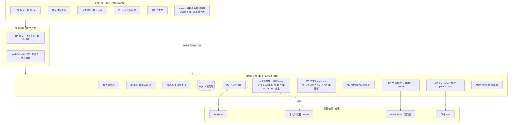
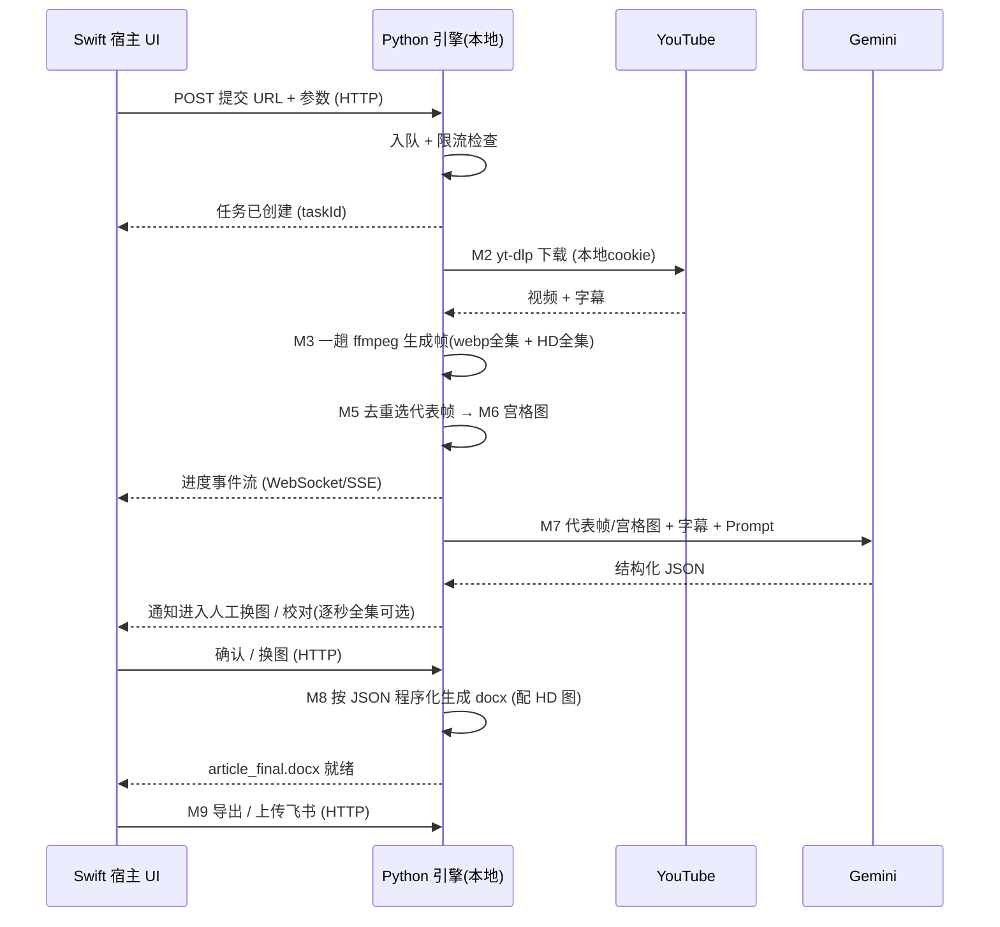

# 视频生成图文文章工具 — 架构设计文档（一期）

> 版本：v0.3（一期 / 纯桌面 macOS 版）
> 目标读者：开发者本人 + 后续协作工程师
> 形态结论：**纯桌面 macOS 应用** —— **Swift UI（宿主） + Python 引擎（本地）**，两者通过本地 HTTP/WebSocket 通信
> 变更摘要（相对 v0.2）：合并图像编码链（一趟 ffmpeg，删除 Pillow 处理）；去重重新定位为「仅服务于喂 Gemini 的代表帧」并默认开启；Gemini 输出改为结构化 JSON，docx 程序化一次性生成（砍掉 BBedit 中转 / 先生成再调图 / 删除中文三步）。受影响模块：M3/M4/M5/M6/M7/M8。

---

## 1. 背景与目标

### 1.1 背景

当前根据 YouTube 视频产出图文文章的流程为纯手工 + 一堆零散命令行脚本：边看视频边手动截图、转格式、上传组内 AI 工具、手动排版配图、人工检验。遇到 15 分钟以上的视频工作量很大，且一次只能处理一个视频。

现有手工流程已经跑通，依赖以下本地命令行工具：`yt-dlp`、`ffmpeg`、`ImageMagick`、`webp(cwebp)`、`Python(Pillow / imagehash / python-docx)`。

### 1.2 一期目标

把现有流程封装成一个可操作的工具，达到：

- 输入 1 个或多个 YouTube URL，工具自动完成**下载 → 帧生成（含水印/转码）→ 去重选帧 → 拼宫格图**的全部预处理；
- 提供文章生成环节（自动调用 Gemini API，或半自动“一键准备好素材供人工粘贴”两种模式）；
- 提供人工换图 / 校对界面；
- 一键导出带配图的 `docx`，并支持导出 / 上传到飞书；
- 内置依赖，免去用户手动 `brew install` 一长串工具。

### 1.3 非目标（一期不做）

- 团队共享的服务端 / 多人协作（留二期）；
- 在线直接截图（不下载视频）——经测试不可行，一期沿用“先下载再抽帧”；
- 完整的权限 / 账号体系；
- 跨平台（仅 macOS，流程深度绑定 macOS 环境）。

---

## 2. 形态决策

### 2.1 为什么是纯桌面（而非服务端）

| 维度 | 桌面 / 本地优先 | 纯 Web（服务端） |
|---|---|---|
| YouTube 风控 | 本机住宅 IP + 本地浏览器 cookie，最贴近正常观看，风险低 | 机房 IP 集中下载，易被限速 / 封禁；需上传个人 cookie，安全隐患 |
| 算力 / 带宽成本 | 白嫖用户本机闲置算力，零边际成本 | 抽帧 / 转码 / 拼图全是 CPU·磁盘密集型，按量付费且难并发 |
| 工具适配 | ffmpeg / yt-dlp / ImageMagick 本就是本地 CLI，打包即用 | 服务端需额外解决沙箱、隔离、临时文件清理 |
| 文件操作 | 大量图片文件夹、docx、人工换图，本地原生 | 反复上传下载，体验差 |
| 团队共享 | 弱（需各自安装） | 强（免安装、集中更新） |

**结论**：一期采用纯桌面应用。团队共享是 Web 的唯一明显优势，但本流水线的下载与重计算无法上服务端，因此把共享能力推迟到二期。

### 2.2 “本地”的准确含义

整个应用 100% 运行在用户本机：UI、Python 引擎、所有 CLI、全部文件、浏览器 cookie 都在本地。其中 Python 引擎虽以 FastAPI 形式监听 `127.0.0.1`，在网络协议意义上是个 server，但在物理位置意义上**从不离开用户电脑**，不部署到任何远程机房。

唯一真正发往远程的，是引擎代码主动发出的**出站第三方 API 调用**，而非运行环境本身：

- `yt-dlp → YouTube`（下载视频 / 字幕）
- `Gemini API`（自动模式生成文章）
- `飞书 API`（发布）

即：进程在本地，只是像浏览器一样对外请求这几个服务。

---

## 3. 技术选型

| 层 | 选型 | 理由 |
|---|---|---|
| UI 宿主 | **Swift + SwiftUI/AppKit**（原生 macOS） | 最地道的 mac 体验；海量逐秒截图的换图画廊用原生 collection view，滚动 / 内存管理最稳 |
| 处理引擎 | **Python + FastAPI**（本机进程，监听 127.0.0.1） | 直接复用现有脚本（imagehash / python-docx 等）；崩溃与 UI 隔离；后端可独立用浏览器 / curl 调试 |
| UI ↔ 引擎通信 | **本地 HTTP + WebSocket/SSE** | 提交任务用 HTTP，推进度用 WS/SSE；用一套干净 API 把引擎与 UI 解耦（详见第 4 节） |
| 编排（队列 / 限流 / 状态机） | **归属 Python 引擎** | 长耗时流水线、重试、限流、SQLite 都在引擎侧集中管理；Swift 保持薄客户端，减少新手需写的复杂异步逻辑 |
| 外部 CLI | yt-dlp / ffmpeg / ffprobe / ImageMagick / cwebp | 随安装包内置二进制，不依赖用户 `brew install` |
| Python 运行时打包 | **python-build-standalone**（首选）或 PyInstaller | 可重定位的独立运行时，随 `.app` 一起分发与签名（详见第 8 节） |
| 任务 / 元数据存储 | **SQLite**（本地单文件，由引擎持有） | 记录任务状态、进度、产物路径，轻量无需独立服务 |
| 素材存储 | 本地文件系统（工作目录） | 详见第 7 节目录约定 |

### 3.1 为什么引擎仍用 Python（而非 Swift 自写或 Go）

引擎 ≈ 90% 是「进程编排 + 调 CLI + 发 HTTP」，真正依赖语言库的只有 **docx 组装（python-docx）** 一处。

- **Python**：复用已跑通的脚本，docx 最顺，**只需新学 Swift 一门**，出活最快、风险最低。代价是把解释器 + 一堆 `.dylib` 打进 `.app` 再签名（第 8 节解决，一次性配置）。
- **Swift 自写引擎**：单运行时最干净，但让 Swift 新手同时写 UI + 健壮的异步流水线编排，且 docx 是弱项，第一版不建议。
- **Go**：单静态二进制、打包最干净，但要再学第二门新语言，且 docx 库不成熟，除非确信 Python 打包会非常痛苦，否则不划算。

职责分工因此定为：**Swift 负责 UI + 托管/监督 Python 子进程的生命周期**；**Python 负责编排 + 处理 + 数据**。

---

## 4. 总体架构与通信边界



分层职责：

- **Swift 宿主**：纯展示与交互 + 原生系统集成（菜单、文件对话框、通知、全磁盘访问引导）；并负责在 app 启动时拉起 Python 引擎、退出 / 崩溃时回收或重启该子进程。不含业务逻辑。
- **本地通信边界**：UI 通过 HTTP 下命令、WS/SSE 收进度。这层是关键解耦点——引擎被一套干净 API 封住后，UI 是 Swift 还是别的都不锁死。
- **Python 引擎**：编排（队列 / 限流 / 状态机）+ 处理（M0–M10）+ 持有 SQLite。每个处理模块设计为「幂等、可单步重跑、产物落盘」，便于失败重试与单步调试。

---

## 5. 核心模块拆分

每个模块对应原流程的一个阶段，均设计为「幂等、可单步重跑、产物落盘」，位于 Python 引擎内。

| 模块 | 名称 | 输入 | 输出 | 实现要点 |
|---|---|---|---|---|
| M0 | 环境自检 / 依赖管理 | — | 各 CLI 可用性报告 | 内置二进制替代手工 `brew install` |
| M1 | 任务输入 & 队列 | URL 列表、参数 | 任务记录入库 | 新增 |
| M2 | 下载引擎 | URL、画质、cookie 来源 | mp4 + 字幕(srt) | `yt-dlp` 合并命令 |
| **M3** | **帧生成（合并原 M3+M4）** | mp4 | ① 640×360+水印 webp 全集；② 1280×720 HD 全集 | **一趟 ffmpeg** 完成抽帧+缩放+水印+转码；**删除原 Pillow 处理** |
| ~~M4~~ | ~~图像处理~~ | — | — | **已并入 M3**（不再单独存在） |
| **M5** | **去重选帧（默认开启）** | 640×360 webp 全集 | **代表帧清单**（供 M6/Gemini） | `imagehash.phash`；**只筛选喂 AI 的那一份，逐秒全集原样保留供换图** |
| M6 | 宫格图 | **去重后代表帧** | 10×5=50 张/组拼图 | ImageMagick `montage`；输入量从数千降到数百 |
| **M7** | **文章生成 → 结构化 JSON** | 宫格图/代表帧 + 字幕 + Prompt | **结构化 JSON**（每页 + meta） | Gemini（自动 API / 手动网页版），Prompt 要求输出 JSON 而非纯文本 |
| **M8** | **文档组装（程序化）** | M7 的 JSON + 1280 HD 图 | `article_final.docx` | python-docx **按结构一次性生成**；**砍掉 BBedit 中转 / 先生成再调图 / 删除中文** |
| M9 | 发布 / 导出 | 最终 docx | 飞书文档 / 本地文件 | 飞书上传（手动 / API 待定） |
| M10 | 视频切片（可选） | mp4 | 等比 800×450 的 N 秒片段 | `ffmpeg` 切分 |

### 5.1 M2 下载引擎（关键）

- 默认画质 1080p，可选 1440p；使用 `<=` 而非 `=`，避免无对应分辨率时下载失败。
- 同时拉取人工英文字幕与自动英文字幕，统一转 `srt`。
- **Cookie**：通过 `--cookies-from-browser`（Safari / Chrome 可选）读取本机浏览器 cookie 过验证——这是必须放在本地的核心原因。
- 失败时给出明确提示（网络 / 浏览器是否关闭 / 完全磁盘访问权限）。

### 5.2 M3 帧生成（优化①：一趟 ffmpeg，合并原 M3+M4）

原链路是 `ffmpeg 抽帧→jpg → Pillow 解码→缩放→加水印→再编码 webp`，存在「解码-编码-解码-编码」的多次有损接力。优化为 **ffmpeg 单趟从源视频直接产出成品帧**：

- 用一条 ffmpeg 命令完成：`fps=1` 抽帧 + `scale=640:360` 缩放 + `drawtext` 烧入时间戳水印（`pts` 取时间，半透明黑底白字、字号 28、左上角固定位置）+ 输出 webp。
- **原 Pillow `process.py` 整段删除**，少一轮完整的解码+编码，画质损失最小。
- 命名直接产出 `HH_MM_SS`（fps=1 从 0 开始，第 N 帧即第 N 秒，纯算术映射），不再 `cp` 出第二份文件夹。
- HD 1280×720 全集由源视频另起一趟 ffmpeg 产出（同样单次解码编码），既供人工换图浏览，又作为 M8 的配图源。
- 实现细节：需校准 `pts` 时间戳与帧序号/文件名的对齐，是细节而非障碍。

### 5.3 M5 去重选帧（优化②：仅服务于喂 AI 的代表帧，默认开启）

逐秒抽帧对 39 分钟视频就是 2340+ 张，相邻帧高度重复。去重不该默认关闭，而应**专门服务于「喂给 Gemini 的那一份」**：

- **逐秒全集（640 webp + 1280 HD）原样保留**，人工换图时仍可逐秒连续挑选，这个能力不丢。
- 用 `imagehash.phash` 在 640×360 webp 上算相似度，**只挑出代表帧清单**进入 M6 拼宫格图。
- 喂 AI 的图量从数千降到数百，宫格图组数、上传量、token 全线下降，配图质量不降反升（AI 不被重复帧干扰）。
- 阈值可配置（参考 15 左右）。

### 5.4 M7 文章生成 → 结构化 JSON（优化③上游）

现有 Prompt 已把每页结构规定得很死（小标题 / 图名 `HH_MM_SS` / 空行 / 正文 + Title/Keywords/Description）。把输出从「纯文本文章」改为 **结构化 JSON**：

- 每页一个对象：`{ "subhead": "...", "image": "HH_MM_SS", "body": "..." }`；
- 文末 meta：`{ "titles": [...], "keywords": [...], "description": "..." }`；
- 中文说明（文章框架对比、配图 CoT）放进**独立字段**，不混入正文。

两种模式：

- **自动模式**：调用 Gemini API，直接拿回 JSON；API Key 存本地，不外传。
- **半自动模式**：沿用免费网页版 Gemini，工具把代表帧/宫格图、字幕、Prompt 备到“一键复制/打开”，人工粘贴后回填 JSON。
- Prompt 以**模板**形式管理，内置默认模板，可编辑、可保存多版本。

### 5.5 M8 文档组装（优化③下游：程序化一次性生成）

原尾链 `Gemini 文本 → BBedit 取序号 → 复制进 docx → python-docx 填空行调图 → 手动删中文` 又长又脆。拿到 M7 的结构化 JSON 后，**python-docx 按结构一次性生成整篇 docx**：

- 序号本就在 JSON 里 → **BBedit 中转取消**；
- 按每页结构直接插小标题、配图（等比居中，配图源取 1280 HD）、正文 → **“先生成普通 docx 再调图填空行”取消**；
- 中文说明在 JSON 独立字段、根本不进正文 → **“删除中文”取消**。

三步合一，且不再依赖任何手工复制粘贴。

---

## 6. 数据流（单任务时序，优化后）



---

## 7. 目录与存储约定

每个任务一个独立工作目录，避免文件互相污染、便于清理：

```
<工作根目录>/
└── <任务ID_视频标题>/
    ├── source/              # 原始 mp4 + 字幕
    ├── 01_hd/               # 1280x720 逐秒 HD (人工换图浏览 + M8 配图源)
    ├── 02_webp/             # 640x360 + 水印 逐秒 webp (供 M5 去重 / M6 宫格图)
    ├── 03_grids/            # 去重后代表帧拼的宫格图 (喂 Gemini)
    ├── article/            # article.json (M7) + article_final.docx (M8)
    ├── mp4_clips/           # 视频切片(可选)
    └── task.json            # 任务元数据快照
```

- M3 一趟 ffmpeg 直接产出 `01_hd/` 与 `02_webp/`，**不再保留原始 `jpg` 中间层**。
- M5 去重只产出**代表帧清单**（可记在 `task.json` 或单独 manifest），逐秒全集不被移动/删除。
- **任务元数据**统一进 SQLite（由 Python 引擎持有：状态、参数、各步骤产物路径、时间戳），`task.json` 为可读快照。
- **素材存哪里**为待定项：本地工作目录是默认方案；是否同步到在线共享文档见第 11 节待讨论。

---

## 8. 打包、签名与分发（macOS）

这是 Swift + Python 组合最费时的一环，一期必须打通，但属一次性配置。

### 8.1 Python 运行时

- 首选 **python-build-standalone**：可重定位的独立 Python 运行时，随 `.app` 内置（`Contents/Resources/python/`）；或用 **PyInstaller** 打成单可执行文件。
- 现有依赖（imagehash / python-docx / fastapi / uvicorn 等）随运行时一起冻结。

### 8.2 内置二进制

- ffmpeg / ffprobe / yt-dlp / ImageMagick(magick, montage) / cwebp 全部放入 `.app` 的 `Contents/Resources/bin/`（或 `Contents/MacOS/`）。
- **最小 PATH 坑**：从 Finder 启动的 app 只有精简 PATH（`/usr/bin:/bin:/usr/sbin:/sbin`），开发时 `ffmpeg` 直跑、打包后会失效——**所有 CLI 必须用 bundle 内绝对路径调用**，不可依赖 PATH。

### 8.3 签名与公证

- 每个内置二进制、每个 `.so`/`.dylib`、Python 主程序均需 **codesign**（带 hardened runtime）；整个 `.app` 再走 **notarytool 公证 + staple**，否则别人机器上被 Gatekeeper 拦。
- 建议把签名 + 公证写进 CI 脚本，避免手工遗漏。

### 8.4 系统权限

- M2 读取浏览器 cookie、读写桌面 / 工作目录可能触发 **完全磁盘访问**；首启提供清晰引导（指向 系统设置 → 隐私与安全性）。

---

## 9. 演进与迁移路径

得益于第 4 节的本地 HTTP/WS 边界，引擎以「干净 API」对外，因此一期不必赌定终局：

- **UI 不锁死**：将来若要换 UI（或二期加 Web 控制台），后端原样不动。
- **引擎可渐进迁 Swift**：图像类步骤（M3/M6/M10）本就是调 CLI，迁到 Swift 几乎零成本；**docx 组装（M8）保留 Python 到最后**，因为它是 Python 的硬优势。
- 即：先用 Python 把流程跑通，再按需逐模块迁移，而非一次性重写。

---

## 10. 一期 vs 二期范围

| 能力 | 一期 | 二期 |
|---|---|---|
| 单机全流程自动化 | ✅ | — |
| 内置依赖、免手工安装 | ✅ | — |
| 人工换图 / 校对界面 | ✅ | 增强 |
| Gemini 自动 / 半自动 | ✅ | — |
| 导出 docx / 飞书 | ✅（飞书上传方式待定） | 飞书 API 自动调图 |
| 团队共享控制台 | ❌ | ✅ 薄 Web 控制台 + 本地 agent |
| 多账号 / 多 IP 调度 | ❌ | 视风控需要评估 |

二期混合架构示意：Web 控制台只做编排与结果查看，真正的下载与处理仍下发到每个人的**本地 agent** 执行（原因仍是 YouTube 风控 + 本地算力）。

---

## 11. 风险与待讨论项（来自原流程的开放问题）

1. **批量策略**：多个 URL 顺序生成还是并发？为防风控建议单次 ≤10 个、间隔 ≥2 小时——需做成可配置的限流参数。
2. **账号 / IP 风险**：多个 URL 用同一 YouTube 账号还是不同账号，风险如何，待评估。
3. **在线截图**：能否跳过下载直接对在线视频截图（此前测试失败）——一期不做，可作为后续优化探索点。
4. **命名一步到位**：已在 M3 随 ffmpeg 输出直接 `HH_MM_SS`，需实测确认无回退到秒数命名的必要。
5. **字幕排版**：yt-dlp 下载的字幕排版不如插件版，token 占用偏多——可考虑自动下载排版好的 transcript 或代码优化排版（另一条待评估优化）。
6. **宫格图 vs 单帧**：网页版受单次传图数量限制需拼宫格图；自动 API 模式下可能直接发去重后单帧更准、且省掉拼图（待评估，另一条优化）。
7. **飞书自动调图**：飞书在线文档 API 自动调取图片尚未研究，二期评估。
8. **素材存储位置**：本地 vs 在线共享文档（腾讯文档 / 坚果云等），需结合协作与体积权衡。
9. **去重阈值校准**：M5 已重新定位为「仅挑喂 AI 的代表帧、默认开启」，相似度阈值（约 15）需按实际素材校准，避免漏掉关键画面。

---

## 12. 下一步

1. 定义第 4 节通信边界的具体 API：Python 暴露哪些 HTTP 端点 + 哪些 WS/SSE 进度事件，以及 M7 结构化 JSON 的字段 schema（把契约定死，UI 实现彻底不影响后端）。
2. 落地优化①：把 M3 写成单趟 ffmpeg 命令（fps+scale+drawtext+webp），验证水印清晰度与时间戳对齐，删除旧 Pillow 脚本。
3. 落地优化②：在 M5 接入 phash 选代表帧，确认逐秒全集与代表帧两条数据流互不干扰。
4. 落地优化③：固化 M7 的 JSON 输出模板，重写 M8 为程序化生成。
5. 打通第 8 节打包链路（python-build-standalone + 内置二进制 + 签名 + 公证）的最小验证。
6. 做最小可用 Swift UI：URL 输入 → 进度看板 → 换图画廊 → 导出。
